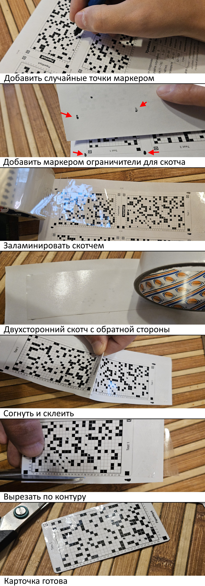

# Как сделать карточку

1. **Сгенерировать и распечатать.** В генераторе введите название, выберите размер, нажмите «Создать» и распечатайте лист на обычном принтере.
2. **Добавить точки маркером.** Чёрным маркером в центр пустых клеток, случайно и на обе стороны поровну. Сколько — в [странице о точках](marks.md).
3. **Проверить в приложении.** На странице проверки сфотографируйте лист целиком: жёлтые и красные клетки подкрасьте и проверьте ещё раз.
4. **Сложить и вырезать.** Согните лист по пунктиру рисунком наружу, склейте половинки и вырежьте карточку по контуру.
5. **Заламинировать скотчем** (по желанию). До складывания наклейте прозрачный скотч на обе стороны: узкая карточка помещается под полосу 48 мм. Чтобы попасть полосой точно, поставьте маркером ограничители по краям. Склеить половинки удобно двусторонним скотчем с обратной стороны.

