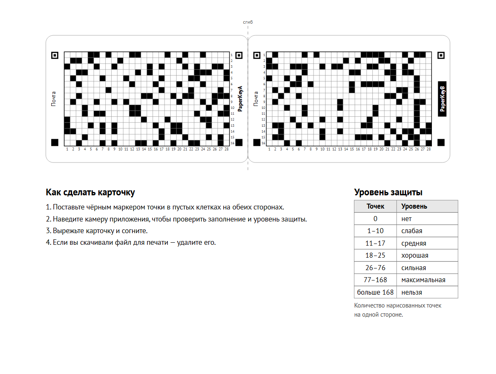

# Карточка PaperKey: что это и зачем

PaperKey — бумажная карточка размером с банковскую, на которой напечатана таблица из чёрных и белых клеток. В этих клетках хранится секретный ключ. Чтобы войти в приложение, вы наводите на карточку камеру телефона — и всё.

## Зачем нужен ключ на бумаге

Пароли забываются, утекают и подбираются. Телефон как единственный ключ — удобно, пока он не потерян, не сломан и не заблокирован. Аппаратные ключи надёжны, но стоят денег и тоже бывают только у тех, кто о них знает.

Бумага решает другую задачу. Карточка:

- **не подключается ни к чему** — её нельзя взломать по сети, на ней нет программ и батарейки;
- **делается дома за десять минут** — принтер, ножницы, маркер;
- **не требует доверия к одному устройству** — ключ лежит в кошельке, а не в памяти телефона, и переживёт смену телефона;
- **понятна** — видно, что именно является ключом, и видно, что никто его не менял.

Карточку можно использовать как ключ для входа, как второй фактор или как запасной ключ восстановления — это решает приложение, которое её принимает.

## Как это работает

На каждой стороне карточки таблица 28 × 16 клеток. Часть клеток закрашена при печати, часть — вами маркером. Телефон читает обе стороны, получает 896 клеток «да / нет» и превращает их в 256-битный ключ.

Три вещи защищают ключ, и каждая работает сама по себе:

1. **Случайная печать.** Клетки для печати выбирает криптографический генератор случайных чисел — тот же, что защищает соединения в браузере. Вариантов заполнения одной стороны больше, чем 2^358, — перебрать невозможно.
2. **Две стороны.** Ключ вычисляется из обеих сторон целиком. Если кто-то сфотографировал одну сторону, второй ему всё равно не хватает, и это полная защита, а не половина.
3. **Ваши метки маркером.** После печати вы сами закрашиваете часть пустых клеток. Если файл карточки перехватили — на компьютере, в очереди печати, в памяти принтера — злоумышленник всё равно не знает, где вы поставили точки.

Сколько точек ставить, зависит от нужного **уровня защиты**:

| Точек на каждой стороне | Уровень | Что это значит |
|---:|---|---|
| 0 | нет | Перехват файла при печати = кража ключа |
| 1–10 | слабая | Защита от перехвата печати неполная |
| 11–17 | средняя | Перебрать нельзя, если точки выбраны случайно |
| 18–25 | хорошая | Есть запас на то, что человек выбирает клетки не совсем случайно |
| 26–76 | сильная | Полная защита даже при перехвате файла |
| 77–168 | максимальная | Выдерживает перехват файла вместе с фотографией одной стороны |
| больше 168 | нельзя | Дальше каждая точка уменьшает непредсказуемость, а не увеличивает |

Точки ставьте на обе стороны примерно поровну: уровень считается по обеим сторонам, и перекос его снижает. Приложение само говорит, какой уровень ему нужен; телефон считает точки и сообщает, достигнут ли он.

## Как сделать карточку

1. Откройте генератор, введите название карточки (например, «Почта»), выберите размер и нажмите «Создать». Получите лист для печати.
2. Напечатайте лист на обычном принтере со стандартными настройками.
3. **Не вырезая**, поставьте чёрным маркером точки в пустых клетках на обеих сторонах. Точка должна закрывать хотя бы половину клетки и не задевать соседние. Клетки выбирайте случайно — удобнее всего бросать кости и находить клетку по номерам столбца и строки, напечатанным у таблицы.
4. Наведите камеру приложения на лист. Оно проверит, что все точки читаются чётко, покажет сомнительные клетки и уровень защиты. Подкрасьте, что нужно, проверьте ещё раз.
5. Вырежьте карточку по контуру — обе половины вместе, согните по пунктиру рисунком наружу и склейте. Узкую карточку удобно заклеить с двух сторон обычным скотчем.
6. Если вы скачивали файл — удалите его.

Карточка готова. Зарегистрируйте её в приложении так, как оно предлагает.

## Три размера

| Размер | Для чего |
|---|---|
| **Стандарт** 85,6 × 54 мм | Как банковская карта: в отделение кошелька |
| **Узкая** 85,6 × 45 мм | То же, но без пустых полей — помещается под полосу обычного скотча 48 мм, которым карточку можно «заламинировать» дома |
| **Мини** 57 × 30 мм | В полтора раза меньше: в чехол телефона, брелок, кармашек |

Таблица на всех размерах одна и та же, различается только размер клетки. У мини она 1,7 мм — точки ставить сложнее, зато карточка почти невидима.

## Карточка половинками

Склеивать половинки не обязательно. Одна сторона сама по себе несёт больше 256 бит печатной случайности, поэтому по одной половинке ключ не получить. Это даёт два сценария:

- **Хранить половинки в разных местах.** Кража или потеря одной половинки ключ не раскрывает — но и вам для входа нужны обе.
- **Передать карточку другому человеку.** Отправьте половинки двумя разными путями — например, двумя курьерами или двумя почтовыми отправлениями. Ни один из посредников по своей половинке ничего не узнает.

Для сканирования половинки показывают по очереди, как стороны обычной карточки; какая из них A, а какая B, сканер определяет сам.

## Как пользоваться

Приложение просит показать карточку — вы наводите камеру сначала на одну сторону, потом на другую, в любом порядке. Телефон распознаёт сторону сам. Через пару секунд вход выполнен.

Одну карточку можно использовать во многих приложениях: для каждого из общего ключа выводится свой отдельный ключ, и ни одно приложение не узнаёт ключ другого.

Страница сканирования после двух сторон показывает три раздела:

- **Единичный пароль** — первые биты ключа карточки, записанные буквами, цифрами, «-» и «_» по 6 бит на символ: 12 символов (72 бита), 18 (108) или 28 (168). Все три начинаются одинаково, поэтому на экране один 28-символьный пароль, а добавки выделены цветом. Это часть самого ключа карточки — для одного сервиса или как пароль, который никуда не вводится.
- **Мастер-пароль** — карточка вместо менеджера паролей. Вводите имя сервиса (при нескольких аккаунтах — с логином: `gmail.com/ivan`) и получаете пароль только для него. Одно имя — всегда один пароль, хранить ничего не нужно; по паролю одного сервиса нельзя узнать ни ключ карточки, ни пароли других. Имя вводите одинаково: регистр и пробелы по краям не важны, а `gmail` и `gmail.com` — разные имена. Сменить пароль на сайте — добавить к имени номер: `gmail.com/2`.
- **Ключ карты** — сам 256-битный ключ, свёрнут по умолчанию. Нужен редко и секретнее всего.

Важно: сканировать карточку должен только сканер PaperKey. Приложение, которое само наводит камеру на карточку, видит клетки целиком и может вычислить все пароли.

Короткий список правил «чего не делать с карточкой» — в [памятке по безопасности](safety.md).

## От чего карточка защищает и от чего нет

**Защищает:**

- от подбора ключа по сети — он слишком длинный;
- от фотографии одной стороны — например, если карточка лежала на столе;
- от перехвата файла при печати — если вы поставили точки.

**Не защищает:**

- от того, кто сфотографировал **обе** стороны готовой карточки. Это ключ на предъявителя: кто видел целиком — тот владеет. Не фотографируйте карточку «на всякий случай» и не храните её скан.
- от потери. Потеряли, постирали, залили — ключ утрачен. Заранее сделайте запасной ключ так, как предлагает приложение: обычно это вторая, другая карточка, зарегистрированная как резервная.
- от вредоносной программы на телефоне в момент сканирования.

## Частые вопросы

**Почему не QR-код?** QR-код печатается целиком и готов сразу — значит, тот, кто перехватил печать, получил ключ. В PaperKey часть ключа появляется только после того, как вы поставили точки маркером. К тому же клетки по 2,5 мм можно закрасить рукой, а модули QR-кода — нет.

**Можно ли закрасить клетку целиком, а не точкой?** Можно, но не нужно: достаточно точки, закрывающей половину клетки. Главное — не задевать соседние.

**Что если точка получилась бледной или маленькой?** Проверка на листе покажет такие клетки — подкрасьте и проверьте снова. Готовая карточка, прошедшая проверку, читается уверенно.

**Сколько времени занимает?** Печать и сборка — пять минут. Точки: уровень «сильная» — 26 точек на каждой стороне, это ещё минут пять.

**Можно ли напечатать карточку в копицентре?** Технически да, но файл с вашей карточкой останется на их компьютере. Это ровно тот случай, от которого защищают точки маркером: ставьте их по уровню «сильная» или выше.

**Карточка потёрлась, клетка испачкалась — что будет?** Если грязь попала в пустую клетку и телефон счёл её закрашенной, ключ не совпадёт, и вход не выполнится. Берегите карточку: скотч или ламинирование помогают. Запасной ключ — обязателен.

**Что делать с файлом после печати?** Удалить, в том числе из корзины. Напечатанная карточка с точками — единственный экземпляр ключа, так и задумано.

## Для разработчиков

Формат карточки открыт и описан в [спецификации](SPEC.md): геометрия, правила чтения, вычисление ключа, тестовые векторы. Откуда берутся числа — 112 печатных клеток, уровни защиты, биты на сторону и на карточку — разобрано в [оценке стойкости](security.md). Сканер может написать кто угодно, и любой сканер прочитает любую карточку одинаково.
