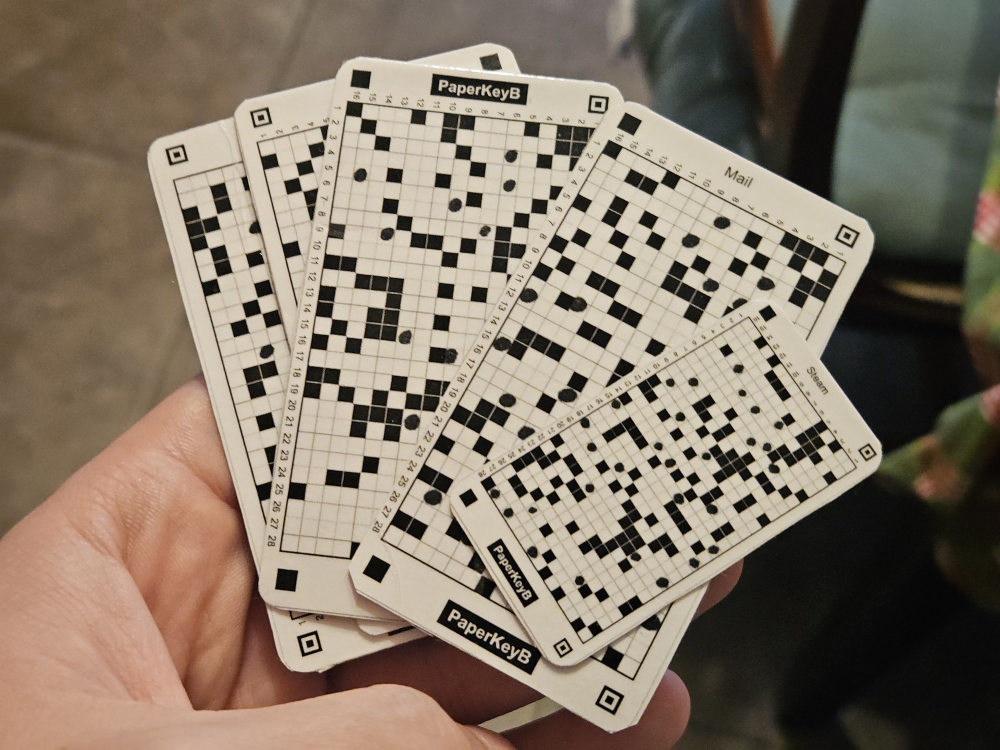

# Карточка PaperKey: что это и зачем

PaperKey — это аналог пароля, записанного на бумажке. Только вместо слова, которое нужно запоминать и набирать, на карточке размером с банковскую напечатана таблица чёрных и белых клеток с 256-битным ключом. Чтобы войти, вы показываете карточку камере телефона.

## Как это работает

На каждой стороне таблица 28 × 16 клеток. Часть закрашена при печати, часть — вами маркером. Телефон читает обе стороны и превращает 896 клеток в ключ. Ключ защищают три независимые вещи:

1. **Случайная печать.** Клетки выбирает криптографический генератор; вариантов одной стороны больше 2^358.
2. **Две стороны.** Ключ вычисляется из обеих целиком: фотография одной стороны ничего не даёт.
3. **Ваши точки маркером.** Их нет ни в одном файле, поэтому перехват файла при печати ключ не раскрывает. Сколько ставить — в [странице о точках](marks.md).

## Как сделать карточку

Сгенерировать и распечатать, поставить точки, проверить в приложении, сложить и вырезать, по желанию заламинировать скотчем. Пять шагов с фотографиями — в [инструкции](making.md). Скачанный файл после печати удалите.

Три размера: **стандарт** 85,6 × 54 мм (как банковская карта), **узкая** 85,6 × 45 мм (помещается под полосу скотча 48 мм) и **мини** 57 × 30 мм (в чехол телефона или брелок). Содержимое и защита одинаковы, различается только размер клетки.

## Карточка половинками

Склеивать половинки не обязательно: по одной половинке ключ не получить. Половинки можно хранить в разных местах или переслать другому человеку двумя разными путями — ни один посредник по своей половинке ничего не узнает. Сканер читает половинки по очереди и сам определяет, какая из них A, а какая B.

## Как пользоваться

Покажите камере одну сторону, потом другую, в любом порядке. После сканирования есть три варианта использования:

- **Единичный пароль** — 12, 18 или 28 символов прямо из ключа карточки; для одного сервиса.
- **Мастер-пароль** — введите имя сервиса (`gmail.com` или `gmail.com/ivan`) и получите пароль только для него. Одно имя — всегда один пароль, хранить ничего не нужно; по паролю одного сервиса нельзя узнать пароли других. Сменить пароль — добавить к имени номер: `gmail.com/2`.
- **Ключ карты** — сам 256-битный ключ; нужен редко и секретнее всего.

## От чего защищает и от чего нет

**Защищает** от подбора по сети, от фотографии одной стороны и от перехвата файла при печати (если есть точки).

**Не защищает** от того, кто сфотографировал обе стороны готовой карточки — это ключ на предъявителя; от потери или порчи — заранее сделайте запасной ключ; от вредоносной программы на телефоне в момент сканирования.

Чего не делать с карточкой — в [памятке по безопасности](safety.md).

## Частые вопросы

**Почему не QR-код?** QR-код готов сразу после печати, и перехват печати равен краже ключа. В PaperKey часть ключа появляется только после ваших точек, а клетки 2,5 мм можно закрасить рукой.

**Можно ли печатать в копицентре?** Да, но файл останется на чужом компьютере — ставьте точки по уровню «средняя» или выше.

**Клетка испачкалась — что будет?** Если телефон счёл пустую клетку закрашенной, ключ не совпадёт. Берегите карточку: скотч помогает, запасной ключ обязателен.

## Для разработчиков

Формат открыт: [спецификация](SPEC.md) описывает геометрию, чтение, вычисление ключа и тестовые векторы; [оценка стойкости](security.md) — откуда берутся 112 печатных клеток, биты и уровни; [устройство кода](code.md) — где что лежит. Любой сканер, написанный по спецификации, прочитает любую карточку одинаково.
